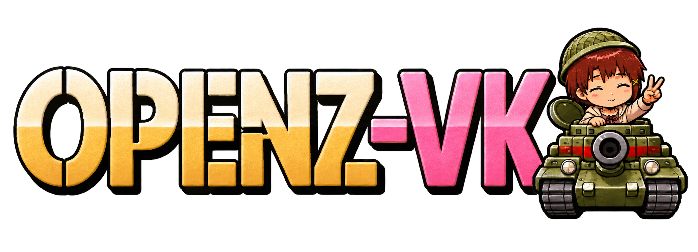

  

[Join the OpenZ Discord (ZZone)](https://discord.gg/WjFqg35PsE) — talk about Z, OpenZ and this fork.

# OpenZ-VK

**OpenZ-VK 1.5.101** is an experimental fork of [OpenZ](https://github.com/playopenz/OpenZ) 1.5, the fan remake of **Z** by **The Bitmap Brothers**.

OpenZ-VK is a place to play with friends, explore optional rules and work with the community toward the combat tactics remembered from Z in 1996. Original OpenZ gameplay remains available: the fork's changes are optional. This is work in progress, and feedback from experienced players is welcome.

## Play your way

- **Online multiplayer:** invite friends with a magic link or connect through TCP/IP. Set up teams or free-for-all matches in the shared lobby, add bots, assign starting forts and chat. Players can follow the host's setup and propose rules for the host to accept. After a match, see the results and return to the lobby together.
- **Teams and spectators:** allies share vision and radar information. Choose the All for One defeat rule for team matches. Eliminated players can watch as ghosts using a free camera or follow a human player.
- **Local Skirmish and solo:** select a battlefield, arrange teams and mix 1996 and 2026 AI opponents. The 2026 AI offers four difficulties, with stronger opponents coordinating attacks and reinforcements. The original OpenZ campaign and difficulty controls remain available.
- **Make the match your own:** choose allowed units, starting forces, fort defenses and optional production and balance rules. Solo choices are independent of the host's multiplayer rules. Fork options outside the lobby are highlighted in violet.
- **AI Maps:** explore converted battlefields across five planets, including low-cost AI reproductions of original Z, expansion and multiplayer maps. Browse minimaps and 3D previews when choosing a battlefield. Official OpenZ levels remain available alongside selected AI versions.
- **Combat profiles and Unit Editor:** use the default OpenZ dynamics or experiment with custom tank and robot behavior. Z Classic is an unfinished attempt to bring back 1996-inspired movement and dodging. The Unit Editor lets you stage fights and create or share profiles.

OpenZ-VK is an early beta: expect bugs and changing rules. Z 1996 is a unit-availability preset, not a complete recreation of the original rules. Existing preferences and personal combat profiles are retained across updates.

## Download and play

Get **OpenZ-VK-Installer.exe** from [the latest OpenZ-VK release](https://github.com/Tablaski/OpenZ/releases/latest). The installer can install or update the compiled game without Unity or Git. It preserves your preferences and reuses unchanged files when updating.

- **Compiled-game ZIPs** are ready to play. For manual installation, extract all Windows ZIP parts from the same release into one folder and run **openz-vk.exe**.
- **Source code** is the editable project on stable `main` or development `dev`; it must be compiled before playing. Development versions are distributed as source only.
- **Unity** is required to compile the source. The installer can guide its setup and build a selected `main` or `dev` revision.
- **Resource ZIPs** contain the base assets needed for source compilation. The installer downloads and reuses the required package.

GitHub's automatic source-code ZIP is not a compiled game. For more detail, see the [installer guide](docs/INSTALLER.md).

Open the **Unit Editor** from the game, the installer, or **Unit Editor/Open Unit Editor.bat** in the compiled game. Online participants should use the same version; the lobby reports version differences.

Read the [changelog](docs/CHANGELOG.md), [combat profile guide](docs/BEHAVIOR_PROFILES.md) and [Unit Editor guide](docs/UNIT_EDITOR.md).

## Credits and licenses

Built on [OpenZ](https://github.com/playopenz/OpenZ) and the simulation rules ported from The Zod Engine. Upstream names, credits and licenses are preserved. See the [original OpenZ presentation](docs/UPSTREAM_README.md), [LICENSE](LICENSE) and [asset credits](docs/LICENSE-ASSETS.md).
