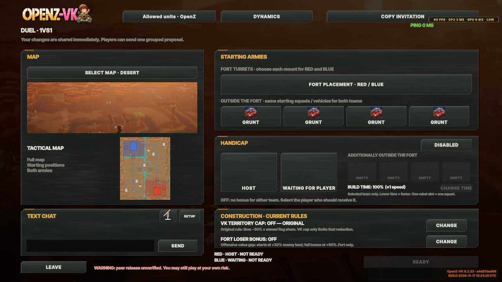

  

[Join the OpenZ Discord (ZZone)](https://discord.gg/WjFqg35PsE) — talk about the original game, OpenZ and this fork.

# OpenZ-VK

**OpenZ-VK 1.5.1** is an experimental fork of [OpenZ](https://github.com/playopenz/OpenZ) 1.5, the fan remake of **Z** by **The Bitmap Brothers**.

## Why this fork?

I want to bring back the combat feel and advanced tactics that Z's 1996 veterans remember, while tackling its rough edges—especially the balance that can turn an early lead into an unstoppable snowball. OpenZ-VK is a place for multiplayer, fairer optional game modes and a laboratory for trying ideas. You can still play with normal OpenZ rules and leave the fork's optional changes off.

This is **work in progress**, not a claim of perfect Z fidelity. If you remember the tricks, duels and hard-earned tactics of the original, come help: play matches, challenge the balance and tell us what feels right—or wrong.

## What can you play with?

- **1 vs 1 duels.** Invite a friend with a link. Chat and voice stay available during a confirmed match pause. The player who pauses can resume. Players can also propose a map change or agree to return to the lobby.
- **Your duel, your rules.** Choose allowed units, starting armies, handicaps and four fort cannon slots per team. On the official **Bridge Game**, the host can allow or exclude the Mammoth and Bizon individually. Your opponent can propose a setup for the host to accept. Optional production rules aim to keep matches competitive for longer.
- **Solo match setup.** Choose allowed units and tank and robot dynamics from the battlefield selector. The Z 1996 roster includes the Light, Medium and Heavy Tanks.
- **AI Maps.** Rediscover 60 battlefields across five planets, from volcanic lava fields to Arctic steel crossings. Browse panoramic 3D previews in solo or explore the 1 vs 1 gallery with large minimaps and terrain filters. The collection includes low-cost AI reproductions of Z Original, Z Expansion and multiplayer maps, plus an original Arctic layout.
- **A combat laboratory for old Z hands.** Use the Unit Editor to stage repeatable fights, compare units and help us work toward the combat dynamics and advanced tactics of 1996. Feedback and contributions from experienced players are very welcome.
- **More choice in solo, too.** Pick allowed units before a mission; the selection applies to both sides. Clearer army comparisons, adjustable flags and dotted territory borders help you read the battlefield. Fork-added options outside the lobby are marked in violet.

**Early beta:** expect bugs and changing rules. Z 1996 is a unit-availability preset, not a complete historical rules mode. Existing preferences and personal combat profiles are retained across updates. The separate experimental map editor is not included.

<table>
  <tr><td colspan="2"></td></tr>
  <tr><td></td><td></td></tr>
</table>

## Download and play

Download **OpenZ-VK-Installer.exe** from [the latest OpenZ-VK release](https://github.com/Tablaski/OpenZ/releases/latest).

- **Compiled-game ZIPs:** ready to play, with no Unity or Git required. For manual installation, extract both ZIPs from the same release into one folder and run **openz-vk.exe**.
- **Source code:** the editable code on stable **main** or development **dev**; it must be compiled before playing. Development versions are distributed as source code only.
- **Unity:** the editor required to compile the source code; the installer helps you install the correct version.
- **Resource ZIPs:** the OpenZ 1.5 base assets with required fork adaptations, needed for source compilation. The installer reuses matching files across updates.
- **Installer:** installs and updates the compiled game, shows its changelog, or retrieves a chosen **main/dev** commit and builds it with Unity. It reuses unchanged data and uses Git when available, with optional Git installation and a Git-free fallback.

GitHub's automatic source-code ZIP is not a ready-to-play compiled game. A startup check detects incompatible resource packages. See the short [installer guide](docs/INSTALLER.md).

**Unit Editor:** click **UNIT EDITOR** in the installer, or open the build's **Unit Editor** folder and double-click **Open Unit Editor.bat**. It is also available in the game's main menu.

Both multiplayer participants need the same version. An interrupted match pauses for up to 30 seconds while the connection is restored.

See the [changelog](docs/CHANGELOG.md), [combat profiles](docs/BEHAVIOR_PROFILES.md), [Unit Editor guide](docs/UNIT_EDITOR.md) and [build instructions](CONTRIBUTING.md). Development is on `dev`.

## Credits and licenses

Built on [OpenZ](https://github.com/playopenz/OpenZ) and the simulation rules ported from The Zod Engine. Upstream names, credits and licenses are preserved. See the [original OpenZ presentation](docs/UPSTREAM_README.md), [LICENSE](LICENSE) and [asset credits](docs/LICENSE-ASSETS.md). For upstream OpenZ, use [its releases](https://github.com/playopenz/OpenZ/releases).
