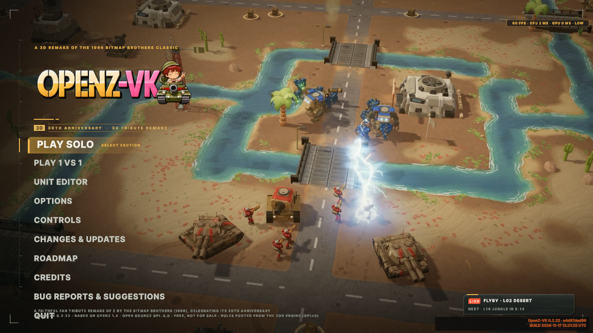
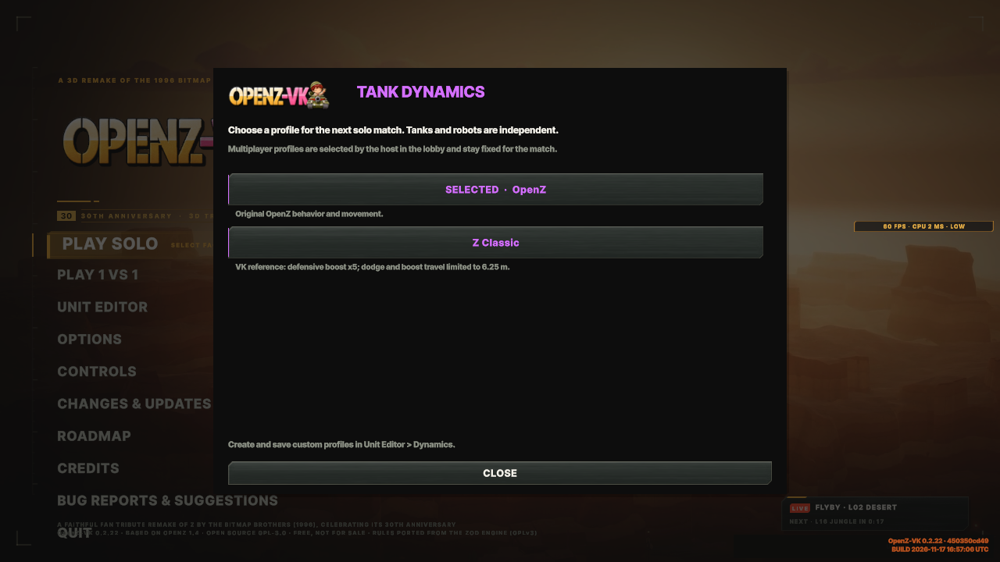
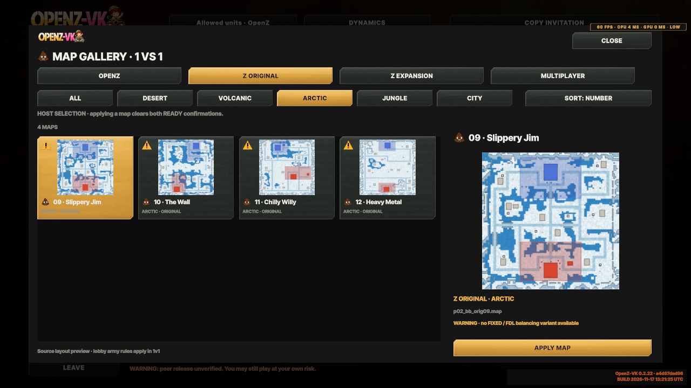
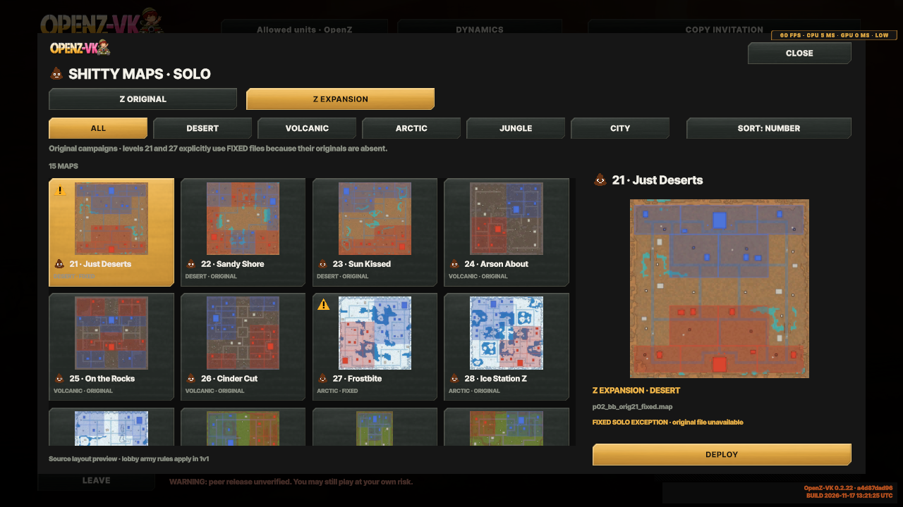

  

# OpenZ-VK

An experimental fork of [OpenZ](https://github.com/playopenz/OpenZ), the fan remake of **Z** by **The Bitmap Brothers**. Early beta: expect bugs and changing rules.

## What changes from OpenZ?

- **1 vs 1 with a friend:** invitations, chat and voice, shared match setup, readiness, surrender, restart requests and end-of-match statistics.
- **More match options:** choose allowed units with OpenZ, Z 1996 or Custom presets; configure starting armies, handicaps and each team's four fort cannons independently. The guest can send one grouped proposal for the host to review.
- **Solo unit selection:** choose OpenZ, Z 1996 or Custom allowed units on the mission selection screen. Your selection applies to both sides for that mission.
- **Custom combat:** tune tank and robot dodging, directional probabilities, boost duration/distance, turning, acceleration and damage effects. Save profiles in the Unit Editor; the host selects the official profiles in the lobby and they stay fixed during the match.
- **Optional balance:** cap the territorial production advantage or give the weaker army a separate fort-production bonus. Leaving the cap off preserves the original territorial advantage.
- **Shitty Maps:** browse converted Z Original, Z Expansion and multiplayer maps with minimaps, terrain filters and sorting, including Arctic terrain. These conversions are experimental.
- **Clearer battles:** compare army counts or offensive production value, resize flags and use dotted territory borders. Added options outside the lobby are highlighted in violet.
- **A richer Unit Editor:** stage repeatable fights, tune both sides live, inspect damage and success counters, and use paired respawns.

Fresh installations supply **OpenZ** and **Z Classic** reference profiles only. Z Classic uses a defensive boost of **×5**, with boost and total dodge travel limited to **6.25 m** (1.25 times a common 5 m explosion radius). Personal profiles are never included in the downloads. The separate experimental map editor is not included in this release.

**Z 1996 is a unit-availability preset, not a complete historical rules mode.** Custom dynamics do not promise identical behavior to Z or The Zod Engine. Existing preferences and saved profiles are retained across updates.

<table>
  <tr><td></td><td></td></tr>
  <tr><td></td><td></td></tr>
  <tr><td></td><td></td></tr>
</table>

## Download and play

Download **OpenZ-VK-Installer.exe** from [the latest OpenZ-VK release](https://github.com/Tablaski/OpenZ/releases/latest). Install a published player and read its changelog, or choose **Build from sources** to select any commit from stable **main** or development **dev** and compile it. The installer detects Git and uses it when present; otherwise it retrieves source snapshots. Git installation is offered as an option.

**Unity is required only for compiling sources.** The installer detects the required editor and guides its installation. It reuses unchanged source resources and prepares a new package when a selected version needs updated assets. Published players require neither Unity nor Git. A startup check detects incompatible resource packages. See the short [installer guide](docs/INSTALLER.md).

For a manual installation, download **both player ZIPs** from the same release and extract both into the same destination. Keep the complete resulting folder together and run **openz-vk.exe**. GitHub's automatic source-code ZIP is not a playable download.

**Unit Editor:** click **UNIT EDITOR** in the installer, or open the build's **Unit Editor** folder and double-click **Open Unit Editor.bat**. It is also available in the game's main menu.

Both multiplayer participants need the same version. Rejoining an interrupted match is not supported; some network connections may fail.

See the [changelog](docs/CHANGELOG.md), [combat profiles](docs/BEHAVIOR_PROFILES.md), [Unit Editor guide](docs/UNIT_EDITOR.md) and [build instructions](CONTRIBUTING.md). Development is on `dev`.

## Credits and licenses

Built on [OpenZ](https://github.com/playopenz/OpenZ) and the simulation rules ported from The Zod Engine. Upstream names, credits and licenses are preserved. See the [original OpenZ presentation](docs/UPSTREAM_README.md), [LICENSE](LICENSE) and [asset credits](docs/LICENSE-ASSETS.md). For upstream OpenZ, use [its releases](https://github.com/playopenz/OpenZ/releases).
